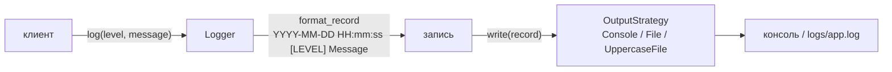
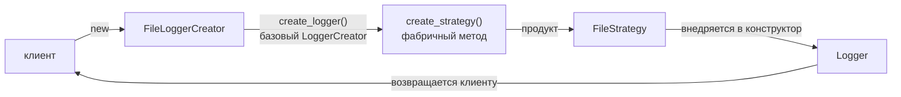

# Лабораторная работа № 3. Рефакторинг программного кода с применением Strategy и Factory Method

## Цели и задачи

- Практически закрепить понимание шаблона **Strategy (Стратегия)**.
- Практически закрепить понимание шаблона **Factory Method (Фабричный метод)**.
- Научиться выявлять разветвлённую логику выбора поведения и заменять её набором взаимозаменяемых объектов.
- Научиться отделять создание конкретных объектов от клиентского кода.
- Закрепить навыки модульного тестирования и ведения репозитория Git.

## Исходный проект

В репозитории находится небольшая программа журналирования сообщений.

Исходная реализация расположена в каталоге `legacy/`. Класс `LegacyLogger` умеет записывать сообщения:

- в консоль;
- в текстовый файл;
- в текстовый файл с преобразованием сообщения в верхний регистр.

Выбор варианта вывода выполняется внутри одного метода с помощью условных конструкций. Это намеренно упрощённая реализация, которую требуется переработать.

До начала работы:

```bash
python -m pytest
python app.py
```

Исходные тесты должны проходить. После рефакторинга существующее внешнее поведение программы необходимо сохранить.

## Задание и порядок выполнения

1. Изучите исходный код в `legacy/logger.py`.
2. Определите, какие обязанности в текущей реализации смешаны в одном классе.
3. Реализуйте шаблон **Strategy**:
   - определите общий интерфейс стратегии вывода;
   - реализуйте стратегию вывода в консоль;
   - реализуйте стратегию записи в файл;
   - реализуйте стратегию записи в файл с преобразованием сообщения в верхний регистр;
   - класс журналирования не должен содержать ветвление по типу выбранного вывода.
4. Реализуйте шаблон **Factory Method** для создания стратегий:
   - клиентский код не должен напрямую создавать конкретные стратегии;
   - создание конкретного объекта должно выполняться через фабричный метод;
   - не подменяйте Factory Method одной функцией с большим `if/elif`.
5. Переведите `app.py` на новую архитектуру.
6. Сохраните формат сообщения:

   ```text
   YYYY-MM-DD HH:mm:ss [LEVEL] Message
   ```

   Допустимые уровни: `TRACE`, `INFO`, `WARN`, `ERROR`, `FATAL`.
7. Добавьте обработку некорректного уровня сообщения.
8. Напишите модульные тесты для каждой стратегии, фабричного метода, форматирования сообщения и ошибочных входных данных.
9. Подготовьте структурную диаграмму решения и сохраните её в каталоге `docs/`.
10. Дополните этот README разделом **«Описание решения»**: укажите роли участников Strategy и Factory Method в вашей реализации.

## Ограничения

- Язык программирования: **Python 3.11+**.
- Не допускается сохранение выбора стратегии внутри `Logger` через `if/elif`, `match` или словарь из функций.
- Конкретные стратегии не должны создаваться внутри основного класса журналирования.
- Не требуется реализовывать Singleton.
- Сторонние библиотеки для реализации шаблонов не требуются.

## Git

Работу следует вести в отдельной ветке. История коммитов должна отражать основные этапы выполнения работы.

Рекомендуется придерживаться соглашения [Conventional Commits](https://www.conventionalcommits.org/en/v1.0.0/).

Пример:

```text
refactor: extract output strategies
feat: add logger creators
test: cover file strategy
docs: add class diagram
```

## Тестирование

```bash
python -m pip install -e ".[dev]"
python -m pytest
```

Предоставленные тесты проверяют только исходный код. Они не заменяют тесты, которые необходимо написать для новой архитектуры.

## Что должно быть в репозитории к защите

- исходный код новой реализации;
- автоматические тесты;
- `README.md` с описанием решения и инструкцией по запуску;
- структурная диаграмма в `docs/`;
- осмысленная история Git.

## Вопросы к защите

1. Какую проектную проблему решает Strategy в вашей реализации?
2. Чем Strategy отличается от обычного набора функций?
3. Где находится контекст шаблона Strategy?
4. Какую обязанность берёт на себя Factory Method?
5. Почему созданное вами решение является Factory Method, а не Simple Factory?
6. Как добавить новый способ вывода, не изменяя существующий код журналирования?
7. Какие альтернативы вы рассматривали?

## Описание решения

Исходный `LegacyLogger` совмещал четыре обязанности: 
- форматирование записи;
- выбор способа вывода (`if/elif` по строковому параметру); 
- выполнение вывода;
- знание деталей файловой системы (mkdir, append, кодировка). 

Производим рефакторинг с исопльзованием паттернов Strategy и Factory Method. 
Каталог `legacy/` остаётся в репозитории нетронутым, как пример, что было до.

### Strategy — стратегии вывода

`Logger` (`logger/logger.py`) для вывода сообщения использует переданную ему стратегию.

| Участник | Роль |
|---|---|
| `OutputStrategy` (`interfaces/`) | общий интерфейс стратегии: `write(record)` |
| `ConsoleStrategy` (`strategies/`) | печатает готовую запись в консоль |
| `FileStrategy` (`strategies/`) | дописывает запись в файл: создаёт каталоги, режим append, utf-8 |
| `UppercaseFileStrategy` (`strategies/`) | запись в файл заглавными буквами; наследует `FileStrategy` и переопределяет только текст — механика записи не дублируется |

Путь одной записи:



### Factory Method — создатели логгеров

Создание стратегий отделено от клиентского кода иерархией создателей.

| Участник | Роль |
|---|---|
| `LoggerCreator` (`factories/`) | создатель: объявляет фабричный метод `create_strategy()` и клиентскую операцию `create_logger()`, написанную один раз против абстракции |
| `ConsoleLoggerCreator` (`factories/`) | переопределяет фабричный метод: возвращает `ConsoleStrategy` |
| `FileLoggerCreator` (`factories/`) | хранит путь файла в конструкторе, возвращает `FileStrategy` |
| `UppercaseFileLoggerCreator` (`factories/`) | наследует `FileLoggerCreator`, возвращает `UppercaseFileStrategy` |

Сборка логгера клиентом (`app.py`):



Решение о том, какой класс инстанцировать, принимают подклассы создателя, 
переопределяя фабричный метод: выбор кодируется типом, а не строковым аргументом. 
Поэтому в решении нет ни `if/elif`, ни словаря-переключателя, а добавление нового способа
вывода не затрагивает существующий код.

### Формат записи и обработка уровня

Формат записи: `YYYY-MM-DD HH:mm:ss [LEVEL] Message`.  
Уровни: `TRACE`, `INFO`, `WARN`, `ERROR`, `FATAL`.

Структурная диаграмма итоговой реализации — в [docs/README.md](docs/README.md).

### Тест-кейсы

**Форматирование (`tests/test_formatting.py`)**

- **Точный формат записи** — параметризация по всем пяти уровням с фиксированным временем → строка `2026-01-02 03:04:05 [LEVEL] hello`.
- **Время по умолчанию — текущее** — вызов без `now` → отметка времени равна текущей секунде.

**Стратегии (`tests/test_strategies.py`)**

- **Консоль печатает запись** — `write()` → stdout равен записи с переводом строки.
- **Файл дописывает и создаёт каталоги** — две записи во вложенный путь → в файле две строки через `\n`.
- **Upper-файл пишет запись заглавными** — запись с `[error]` → в файле `[ERROR] SOMETHING ...`: преобразуется вся строка.

**Logger (`tests/test_logger.py`)**

- **Запись возвращается и уходит в стратегию без изменений** — шпион `RecordingStrategy`: единственная полученная запись равна возвращённой строке.
- **Строчный уровень принимается** — `log("WARN", ...)` → запись содержит `[WARN]`.
- **Неизвестный уровень отклоняется** — параметризация `"DEBUG"`, `"info"`, `""`, `42`, `None` → `ValueError`, стратегия не вызвана.

**Фабрики (`tests/test_factories.py`)**

- **Фабричный метод возвращает свой продукт** — параметризация по трём создателям → `create_strategy()` возвращает экземпляр ожидаемой конкретной стратегии.
